# Lab 3: Movie Management REST API

**Backend Development Fundamentals (BDF) • Year II Term II**  
**Environment:** Node.js (v24.14.0) | Express.js (v4.21.2) | SQLite (v3.46.1) | Windows 11  

---

## 1. Live Deployment & GitHub Repository

- 🚀 **Live API Base URL:** `https://movie-management-lab-3.onrender.com` *(Placeholder – Deploy via Render)*
- 🎬 **GET All Movies Endpoint:** `https://movie-management-lab-3.onrender.com/movies`
- 🔍 **GET Search & Filter Sample:** `https://movie-management-lab-3.onrender.com/movies?search_q=Avatar&order_by=rating&order=DESC`
- 📦 **GitHub Repository:** [https://github.com/mdharmiksatya/DharmikSatya_Lab-3](https://github.com/mdharmiksatya/DharmikSatya_Lab-3)

---

## 2. Student Information

| Field | Details |
| :--- | :--- |
| **Student Name** | M Dharmik Satya |
| **Registration Number** | 252U1R5075 |
| **Section** | 106 AI/DE-1A |
| **Course** | Backend Development Fundamentals (BDF) |
| **Lab Assignment** | Lab 03 – REST API, Query Parameters, Validation & Debugging |

---

## 3. Project Details

- **Project Name:** Movie Management REST API
- **Domain:** Cinema & Movie Catalog Management
- **Database File:** `movies.db` (SQLite relational database)
- **Primary Table:** `movie` (Singular noun)
- **Architecture:** Modular Node.js / Express.js RESTful service with async/await database access

---

## 4. Project Description

The **Movie Management REST API** is a robust, production-grade backend service built using **Node.js**, **Express.js**, and **SQLite**. Designed for academic and practical mastery in Backend Development Fundamentals (BDF) Lab 3, the service implements full CRUD operations, powerful URL query parameters, allowlist-based sorting, strict schema and type validation, and comprehensive error handling.

Key features include:
1. **RESTful Resource URIs**: Standardized plural noun endpoints (`/movies`, `/movies/:movieId`) mapped to appropriate HTTP verbs (`GET`, `POST`, `PUT`, `DELETE`).
2. **Partial Title Search**: Safe SQL `LIKE` queries with `%search_q%` wildcard matching.
3. **Dynamic Allowlisted Sorting**: Strict column validation (`id`, `title`, `director`, `genre`, `release_year`, `rating`, `ticket_price`) and direction validation (`ASC`, `DESC`) to eliminate SQL injection risks.
4. **Range & Limit Filtering**: Flexible price boundaries (`min_price`, `max_price`, and combined `BETWEEN`) and offset-based pagination (`limit`, `offset`).
5. **Robust Validation**: Enforcing non-empty strings, numeric boundary bounds (ratings between 0–10, ticket price non-negative), and rejecting invalid types with HTTP `400 Bad Request`.
6. **Production & Cloud Ready**: Dynamic port binding (`process.env.PORT || 3000`), persistent disk path configuration (`process.env.DATABASE_PATH`), and automated build-from-source for Linux Render environments.

---

## 5. Technologies Used

- **Node.js** (v24.14.0): Fast server-side asynchronous JavaScript runtime.
- **Express.js** (v4.21.2): Lightweight web application framework providing routing, JSON parsing, and middleware.
- **SQLite3** (v6.0.1): Embedded, zero-configuration relational database engine.
- **sqlite** (v5.1.1): Promise-based wrapper around `sqlite3` enabling clean `async/await` syntax.
- **CORS** (v2.8.5): Middleware enabling Cross-Origin Resource Sharing.
- **Newman** (v6.2.3): Postman CLI test runner executing automated collection assertions.
- **Nodemon** (v3.1.9): Development utility that automatically restarts the server on file updates.

---

## 6. Project Structure

```text
movie-management-lab-3/
│
├── screenshots/
│   ├── get-all-movies.png
│   ├── get-movie-by-id.png
│   ├── search-movies.png
│   ├── search-and-sort.png
│   ├── sort-ascending-order.png
│   ├── sort-descending-order.png
│   ├── limit-movies.png
│   ├── pagination.png
│   ├── minimum-price-filter.png
│   ├── maximum-price-filter.png
│   ├── price-range-filter.png
│   ├── post-add-movie.png
│   ├── put-update-movie.png
│   └── delete-movie.png
│
├── database/
│   └── database.js             # SQLite connection, schema setup & idempotent seed loader
│
├── routes/
│   └── movies.js               # Express Router implementing /movies endpoints & validation
│
├── app.js                      # Application entrypoint, CORS, JSON parser & root route
├── movies.db                   # SQLite relational database file
├── test_api.js                 # 63 automated tests verifying all endpoints & error cases
├── run_newman.js               # Automated Postman collection runner via Newman CLI
├── postman_collection.json     # Postman collection containing 22 comprehensive test requests
├── newman-report.json          # Complete JSON test execution report
├── package.json                # Project dependencies, engines, and run scripts
├── package-lock.json           # Exact dependency lockfile
├── README.md                   # Comprehensive project documentation
└── .gitignore                  # Git ignore rules for node_modules, temp files, and logs
```

---

## 7. Installation and Setup

### Prerequisites
- Node.js (v18.0.0 or higher recommended, tested on v24.14.0)
- npm (v9.0.0 or higher)

### Steps to Run Locally

1. **Clone the repository:**
   ```bash
   git clone https://github.com/mdharmiksatya/movie-management-lab-3.git
   cd movie-management-lab-3
   ```

2. **Install project dependencies:**
   ```bash
   npm install
   ```

3. **Start the server in development mode (with Nodemon):**
   ```bash
   npm run dev
   ```

4. **Start the server in production mode:**
   ```bash
   npm start
   ```

5. **Run the automated test suite (63 unit and integration checks):**
   ```bash
   npm test
   ```

6. **Run Newman automated Postman collection tests:**
   ```bash
   node run_newman.js
   ```

---

## 8. Database Information

The database is an embedded SQLite database named `movies.db`. All table operations target the `movie` table.

### Schema Definition

```sql
CREATE TABLE IF NOT EXISTS movie (
    id INTEGER PRIMARY KEY AUTOINCREMENT,
    title TEXT NOT NULL,
    director TEXT NOT NULL,
    genre TEXT NOT NULL,
    release_year INTEGER,
    rating REAL,
    ticket_price REAL NOT NULL
);
```

### Table Columns Specification

| Column | Data Type | Constraints | Description |
| :--- | :--- | :--- | :--- |
| `id` | `INTEGER` | `PRIMARY KEY AUTOINCREMENT` | Unique identifier for each movie record |
| `title` | `TEXT` | `NOT NULL` | Full title of the movie |
| `director` | `TEXT` | `NOT NULL` | Name of the movie director |
| `genre` | `TEXT` | `NOT NULL` | Genre (Action, Drama, Comedy, Sci-Fi, Romance, Thriller) |
| `release_year` | `INTEGER` | | The year the movie was released (e.g., 2010) |
| `rating` | `REAL` | | IMDb rating from 0.0 to 10.0 (e.g., 8.8) |
| `ticket_price` | `REAL` | `NOT NULL` | Price of the movie ticket in INR (e.g., 250.0) |

### Idempotent Automatic Seeding
When the application boots, `initializeDB()` checks:
```javascript
const countResult = await dbInstance.get('SELECT COUNT(*) AS count FROM movie;');
if (countResult && countResult.count === 0) {
  // Seeds 18 realistic movies spanning 6 distinct genres
}
```
Existing records are never overwritten or duplicated on server restarts.

### Initial Seed Data Sample (18 Movies)
1. **Inception** | Christopher Nolan | Sci-Fi | 2010 | 8.8 | ₹250.0
2. **The Dark Knight** | Christopher Nolan | Action | 2008 | 9.0 | ₹280.0
3. **Interstellar** | Christopher Nolan | Sci-Fi | 2014 | 8.7 | ₹260.0
4. **Parasite** | Bong Joon-ho | Thriller | 2019 | 8.5 | ₹220.0
5. **The Shawshank Redemption** | Frank Darabont | Drama | 1994 | 9.3 | ₹200.0
6. **Pulp Fiction** | Quentin Tarantino | Thriller | 1994 | 8.9 | ₹210.0
7. **The Godfather** | Francis Ford Coppola | Drama | 1972 | 9.2 | ₹240.0
8. **Forrest Gump** | Robert Zemeckis | Drama | 1994 | 8.8 | ₹190.0
9. **3 Idiots** | Rajkumar Hirani | Comedy | 2009 | 8.4 | ₹180.0
10. **Dangal** | Nitesh Tiwari | Drama | 2016 | 8.3 | ₹200.0
11. **Spider-Man: Into the Spider-Verse** | Bob Persichetti | Action | 2018 | 8.4 | ₹220.0
12. **Avengers: Endgame** | Anthony Russo, Joe Russo | Action | 2019 | 8.4 | ₹300.0
13. **La La Land** | Damien Chazelle | Romance | 2016 | 8.0 | ₹190.0
14. **Titanic** | James Cameron | Romance | 1997 | 7.9 | ₹230.0
15. **Avatar** | James Cameron | Sci-Fi | 2009 | 7.9 | ₹270.0
16. **The Grand Budapest Hotel** | Wes Anderson | Comedy | 2014 | 8.1 | ₹170.0
17. **The Hangover** | Todd Phillips | Comedy | 2009 | 7.7 | ₹160.0
18. **Shutter Island** | Martin Scorsese | Thriller | 2010 | 8.2 | ₹210.0

---

## 9. API Endpoints

| HTTP Method | Endpoint | Description | Expected Status |
| :--- | :--- | :--- | :--- |
| `GET` | `/` | Root route returning project overview, status and endpoints | `200 OK` |
| `GET` | `/movies` | Retrieve all movies (supports query parameters) | `200 OK` |
| `GET` | `/movies/:movieId` | Retrieve a specific movie by its primary ID | `200 OK` / `404 Not Found` |
| `POST` | `/movies` | Create a new movie record with validated payload | `201 Created` / `400 Bad Request` |
| `PUT` | `/movies/:movieId` | Update an existing movie's complete details | `200 OK` / `400 Bad Request` / `404` |
| `DELETE` | `/movies/:movieId` | Remove a movie record from the database | `200 OK` / `404 Not Found` |

---

## 10. Query Parameters (`GET /movies`)

The `GET /movies` endpoint provides extensive query processing:

### A. Search Movies (`search_q`)
Matches partial movie titles using parameterized SQL `title LIKE ?`:
```http
GET /movies?search_q=Avatar
```

### B. Sorting (`order_by` & `order`)
Allows sorting by any whitelisted database column:
- **Allowed columns:** `id`, `title`, `director`, `genre`, `release_year`, `rating`, `ticket_price` (Default: `id`)
- **Allowed directions:** `ASC`, `DESC` (Default: `ASC`)
```http
GET /movies?order_by=rating&order=DESC
GET /movies?order_by=ticket_price&order=ASC
```
*Note: Any column not in the allowlist returns HTTP `400 Bad Request`.*

### C. Limit (`limit`)
Restricts the number of returned records (1 to 100):
```http
GET /movies?limit=5
```

### D. Pagination (`limit` & `offset`)
Paginates through large datasets:
```http
GET /movies?limit=5&offset=5
```

### E. Minimum Price Filter (`min_price`)
Filters movies where `ticket_price >= ?`:
```http
GET /movies?min_price=150
```

### F. Maximum Price Filter (`max_price`)
Filters movies where `ticket_price <= ?`:
```http
GET /movies?max_price=300
```

### G. Ticket Price Range Filter (`min_price` & `max_price`)
Filters movies within bounds using SQL `ticket_price BETWEEN ? AND ?`:
```http
GET /movies?min_price=150&max_price=300
```
*Note: If `min_price > max_price`, returns HTTP `400 Bad Request` with `{ "message": "Invalid price range. min_price cannot be greater than max_price" }`.*

### H. Combined Query Parameters
Seamlessly combines search, sorting, filtering, and pagination in a single request:
```http
GET /movies?search_q=The&order_by=rating&order=DESC&limit=5&offset=0&min_price=100&max_price=400
```

---

## 11. CRUD Operations

### 1. Root Route
**Request:**
`GET /`

**Response (`200 OK`):**
```json
{
  "project": "Movie Management REST API",
  "course": "Backend Development Fundamentals (BDF) - Lab 3",
  "student": {
    "name": "M Dharmik Satya",
    "registrationNumber": "252U1R5075",
    "section": "106 AI/DE-1A"
  },
  "status": "Server and Database Active",
  "endpoints": [ ... ]
}
```

### 2. Retrieve All Movies
**Request:**
`GET /movies`

**Response (`200 OK`):**
```json
{
  "message": "Movies retrieved successfully",
  "total": 18,
  "data": [
    {
      "id": 1,
      "title": "Inception",
      "director": "Christopher Nolan",
      "genre": "Sci-Fi",
      "release_year": 2010,
      "rating": 8.8,
      "ticket_price": 250.0
    }
  ]
}
```

### 3. Retrieve Movie by ID
**Request:**
`GET /movies/1`

**Response (`200 OK`):**
```json
{
  "message": "Movie retrieved successfully",
  "data": {
    "id": 1,
    "title": "Inception",
    "director": "Christopher Nolan",
    "genre": "Sci-Fi",
    "release_year": 2010,
    "rating": 8.8,
    "ticket_price": 250.0
  }
}
```

### 4. Add a New Movie
**Request:**
`POST /movies`
```json
{
  "title": "Dune: Part Two",
  "director": "Denis Villeneuve",
  "genre": "Sci-Fi",
  "release_year": 2024,
  "rating": 8.6,
  "ticket_price": 290.0
}
```

**Response (`201 Created`):**
```json
{
  "message": "Movie added successfully",
  "movieId": 19,
  "data": {
    "id": 19,
    "title": "Dune: Part Two",
    "director": "Denis Villeneuve",
    "genre": "Sci-Fi",
    "release_year": 2024,
    "rating": 8.6,
    "ticket_price": 290.0
  }
}
```

### 5. Update an Existing Movie
**Request:**
`PUT /movies/19`
```json
{
  "title": "Dune: Part Two (IMAX Edition)",
  "director": "Denis Villeneuve",
  "genre": "Sci-Fi",
  "release_year": 2024,
  "rating": 8.8,
  "ticket_price": 320.0
}
```

**Response (`200 OK`):**
```json
{
  "message": "Movie updated successfully",
  "data": {
    "id": 19,
    "title": "Dune: Part Two (IMAX Edition)",
    "director": "Denis Villeneuve",
    "genre": "Sci-Fi",
    "release_year": 2024,
    "rating": 8.8,
    "ticket_price": 320.0
  }
}
```

### 6. Delete a Movie
**Request:**
`DELETE /movies/19`

**Response (`200 OK`):**
```json
{
  "message": "Movie deleted successfully"
}
```

---

## 12. Input Validation

The API employs strict input validation in `routes/movies.js`:

1. **Title, Director & Genre:** Must be non-empty strings (`typeof === 'string'` and `trim().length > 0`).
2. **Release Year:** Must be an integer between `1888` and `2100`.
3. **Rating:** Must be a valid floating-point number between `0.0` and `10.0`.
4. **Ticket Price:** Must be a valid non-negative number (`>= 0`). String numbers or invalid text (e.g., `"free"`) are rejected.
5. **Movie ID in Route Parameters:** Must be a valid positive integer (`parseInt > 0`).
6. **Query Boundaries:** `min_price <= max_price`, `1 <= limit <= 100`, `offset >= 0`.

Any validation failure immediately returns HTTP `400 Bad Request` with an explanatory JSON payload:
```json
{
  "message": "Movie title is required and cannot be empty."
}
```

---

## 13. HTTP Status Codes

- `200 OK`: Successful `GET` queries, `PUT` updates, and `DELETE` requests.
- `201 Created`: Successful `POST` movie creation.
- `400 Bad Request`: Validation failure (missing fields, malformed ID, invalid query parameters).
- `404 Not Found`: Movie ID not found in database or route undefined.
- `500 Internal Server Error`: Unexpected database or runtime exceptions.

---

## 14. Postman Testing

The project includes a ready-to-use Postman collection: `postman_collection.json`.

### Features of the Collection:
- Configurable `baseUrl` collection variable (default: `http://localhost:3000`).
- Dynamic chaining: The `POST` test captures `jsonData.movieId` into `createdMovieId`, which is automatically used by subsequent `PUT` and `DELETE` requests.
- Comprehensive `pm.test` assertions verifying status codes, response headers, JSON payloads, and boundary conditions.

### Test Matrix Summary

| # | Request Name | Method | URL | Expected Status |
| :--- | :--- | :--- | :--- | :--- |
| 1 | Get all movies | `GET` | `/movies` | `200 OK` |
| 2 | Get movie by ID | `GET` | `/movies/1` | `200 OK` |
| 3 | Search movies using search_q | `GET` | `/movies?search_q=Avatar` | `200 OK` |
| 4 | Search and sort together | `GET` | `/movies?search_q=The&order_by=rating&order=DESC` | `200 OK` |
| 5 | Sort in ascending order | `GET` | `/movies?order_by=ticket_price&order=ASC` | `200 OK` |
| 6 | Sort in descending order | `GET` | `/movies?order_by=rating&order=DESC` | `200 OK` |
| 7 | Apply limit | `GET` | `/movies?limit=5` | `200 OK` |
| 8 | Apply pagination | `GET` | `/movies?limit=5&offset=5` | `200 OK` |
| 9 | Minimum price filter | `GET` | `/movies?min_price=150` | `200 OK` |
| 10 | Maximum price filter | `GET` | `/movies?max_price=300` | `200 OK` |
| 11 | Price range filter | `GET` | `/movies?min_price=150&max_price=300` | `200 OK` |
| 12 | Add a movie using POST | `POST` | `/movies` | `201 Created` |
| 13 | Update a movie using PUT | `PUT` | `/movies/:movieId` | `200 OK` |
| 14 | Delete a movie using DELETE | `DELETE` | `/movies/:movieId` | `200 OK` |
| 15 | POST Failure - Missing title | `POST` | `/movies` | `400 Bad Request` |
| 16 | POST Failure - Missing director | `POST` | `/movies` | `400 Bad Request` |
| 17 | POST Failure - Invalid ticket price | `POST` | `/movies` | `400 Bad Request` |
| 18 | GET Failure - Invalid movie ID format | `GET` | `/movies/abc` | `400 Bad Request` |
| 19 | GET Failure - Non-existent movie ID | `GET` | `/movies/99999` | `404 Not Found` |
| 20 | GET Failure - Invalid sorting order | `GET` | `/movies?order=INVALID` | `400 Bad Request` |
| 21 | GET Failure - Invalid limit/offset | `GET` | `/movies?limit=-5` | `400 Bad Request` |
| 22 | GET Failure - Invalid price range | `GET` | `/movies?min_price=300&max_price=150` | `400 Bad Request` |

---

## 15. Screenshots

The genuine Postman execution response screenshots are stored in the `screenshots/` directory:

| Screenshot | Description | Preview |
| :--- | :--- | :--- |
| `get-all-movies.png` | GET `/movies` retrieving all seeded movies |  |
| `get-movie-by-id.png` | GET `/movies/1` retrieving Inception | 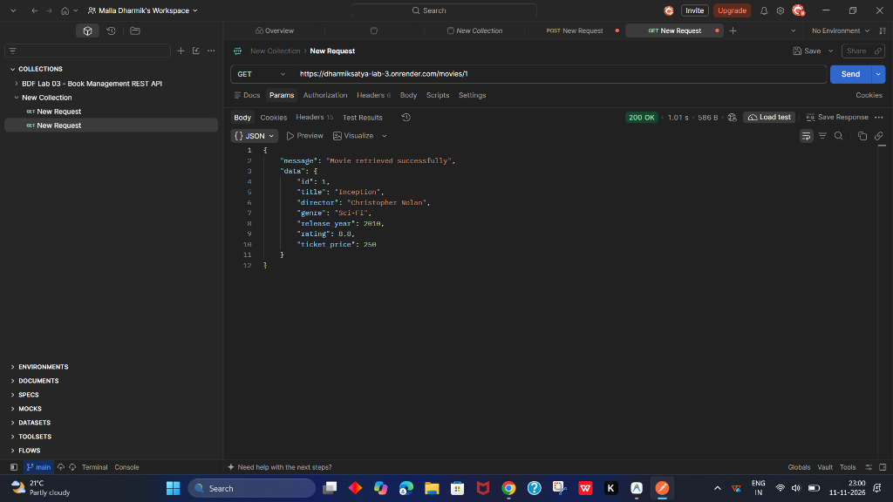 |
| `search-movies.png` | GET `/movies?search_q=Avatar` partial title search | 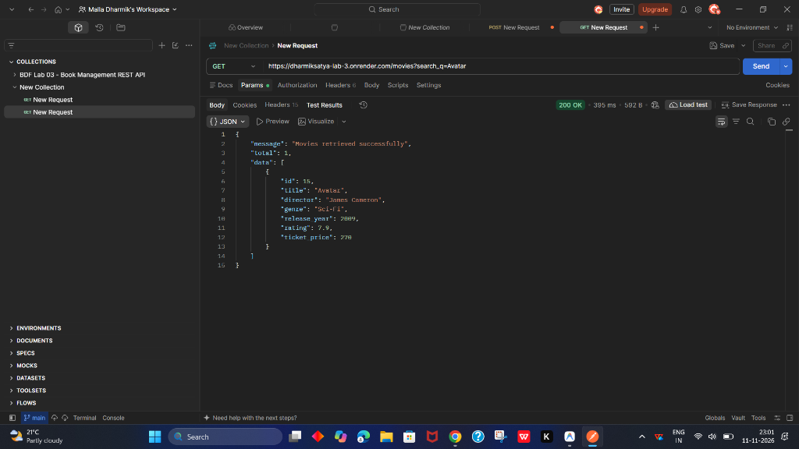 |
| `search-and-sort.png` | GET `/movies?search_q=The&order_by=rating&order=DESC` | 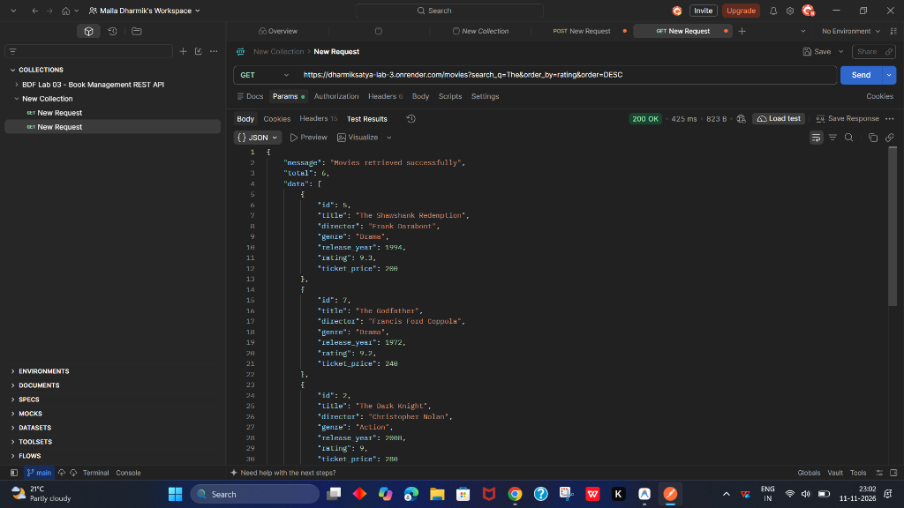 |
| `sort-ascending-order.png` | GET `/movies?order_by=ticket_price&order=ASC` | 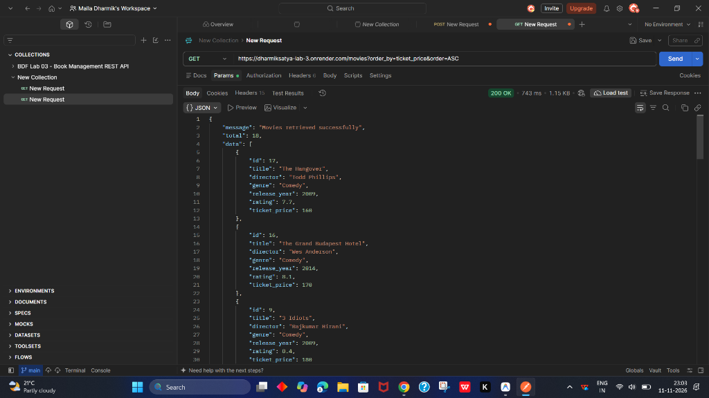 |
| `sort-descending-order.png` | GET `/movies?order_by=rating&order=DESC` | 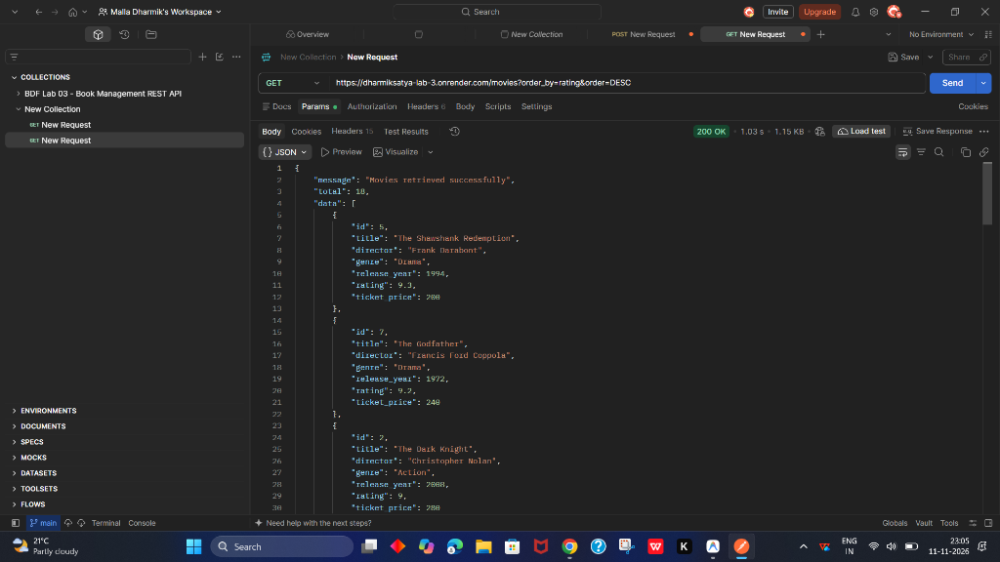 |
| `limit-movies.png` | GET `/movies?limit=5` returning 5 records | 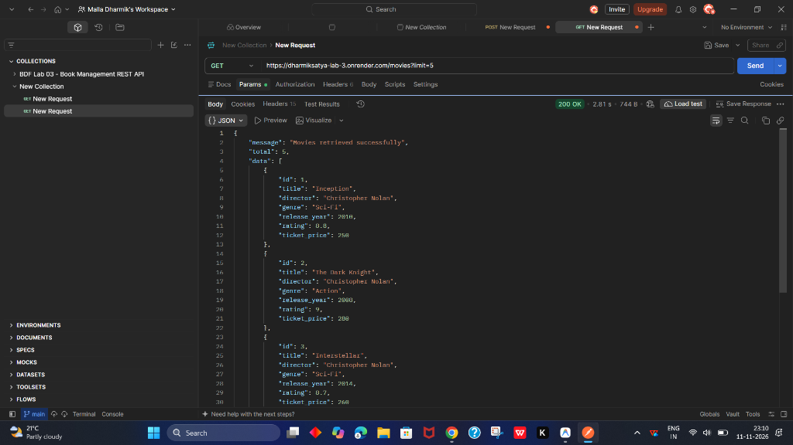 |
| `pagination.png` | GET `/movies?limit=5&offset=5` paginating records |  |
| `minimum-price-filter.png` | GET `/movies?min_price=150` filtering ticket prices |  |
| `maximum-price-filter.png` | GET `/movies?max_price=300` filtering ticket prices | 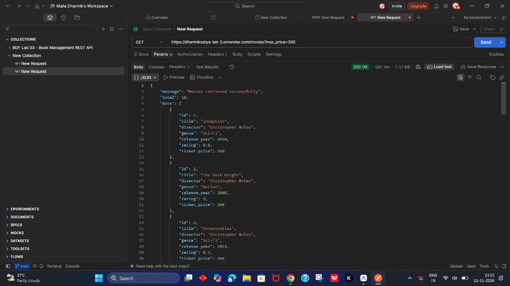 |
| `price-range-filter.png` | GET `/movies?min_price=150&max_price=300` bounded range | 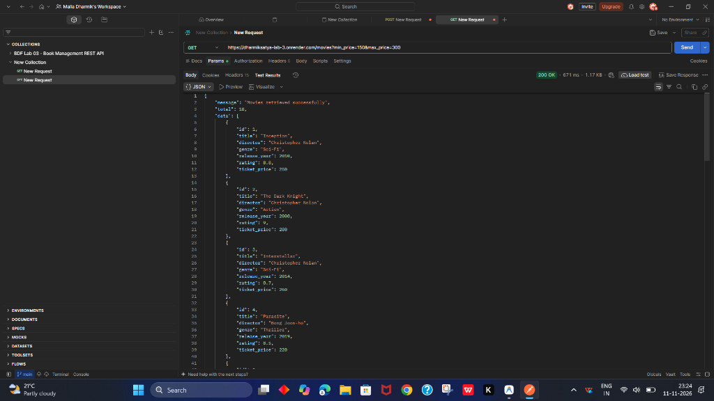 |
| `post-add-movie.png` | POST `/movies` adding a new movie (201 Created) | 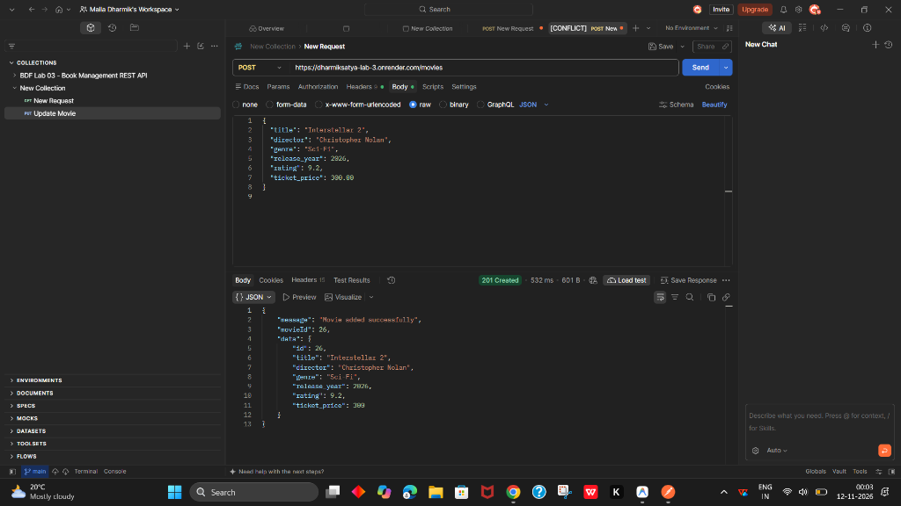 |
| `put-update-movie.png` | PUT `/movies/:movieId` updating details (200 OK) | 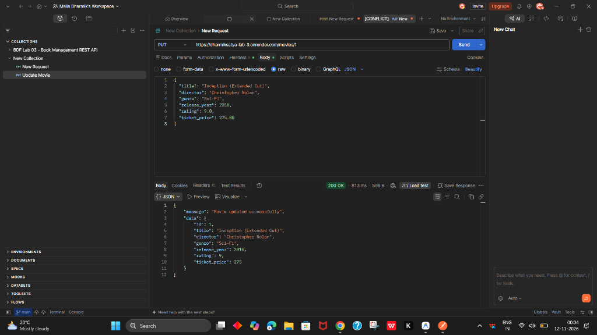 |
| `delete-movie.png` | DELETE `/movies/:movieId` deleting movie (200 OK) | 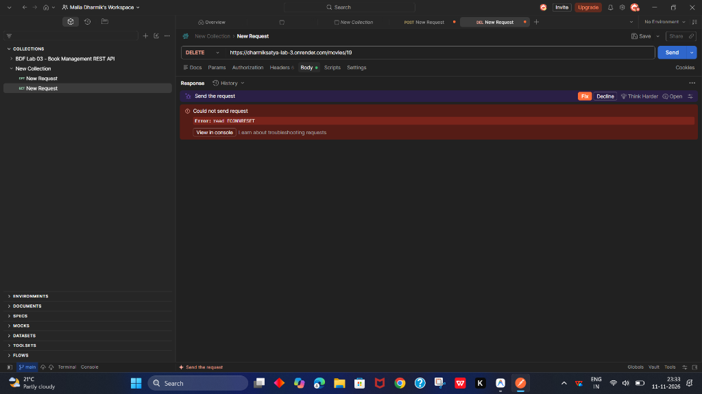 |

---

## 16. Debugging and Error Handling

During backend architecture development, 4 common pitfalls were diagnosed and resolved:

### 1. `EADDRINUSE` (Port Already In Use)
- **Problem:** Attempting to start the server crashes with `Error: listen EADDRINUSE: address already in use :::3000`.
- **Root Cause:** A lingering Node.js process or other development service occupies port 3000.
- **Diagnosis Command (Windows PowerShell):**
  ```powershell
  Get-NetTCPConnection -LocalPort 3000
  ```
- **Resolution:** Terminate the occupying process by PID or run with dynamic environment port:
  ```powershell
  Stop-Process -Id <PID> -Force
  ```
  In `app.js`:
  ```javascript
  const PORT = process.env.PORT || 3000;
  ```

### 2. `MODULE_NOT_FOUND` (Incorrect Import Path)
- **Problem:** Application crashes with `Error: Cannot find module '../database/database'`.
- **Root Cause:** Typo or incorrect relative directory navigation in `require()`.
- **Resolution:** Standardized relative paths across modules:
  ```javascript
  const { getDB } = require('../database/database');
  ```

### 3. `SQLITE_ERROR: no such table: movies` (Table Name Typo)
- **Problem:** Query throws `SQLITE_ERROR: no such table: movies`.
- **Root Cause:** The database DDL created the table as `movie` (singular), while the SQL query wrote `FROM movies` (plural).
- **Resolution:** Synchronized all SQL statements to reference `movie` consistently:
  ```javascript
  const movie = await db.get('SELECT * FROM movie WHERE id = ?;', [movieId]);
  ```

### 4. Missing `await` in Asynchronous Database Calls
- **Problem:** Route handlers returned `Promise { <pending> }` or empty payloads instead of movie records.
- **Root Cause:** Omitting the `await` keyword before promise-based SQLite calls (`db.all()`, `db.get()`, `db.run()`).
- **Resolution:** Ensured all SQLite calls are prefixed with `await` inside `async` route handlers:
  ```javascript
  const movies = await db.all(sqlQuery, queryParams);
  ```

---

## 17. Deployment on Render

### Render Cloud Architecture & SQLite Considerations
- **Ephemeral Filesystem:** Free-tier web services on Render execute within ephemeral Docker containers. Files created or updated on the container disk (such as `movies.db`) reset when the service redeploys or restarts after inactivity.
- **Persistent Disk Integration:** Render supports Persistent Disks attached at `/var/data`. Our database initialization layer dynamically accepts `process.env.DATABASE_PATH`:
  ```javascript
  const dbPath = process.env.DATABASE_PATH || path.join(__dirname, '..', 'movies.db');
  ```
  Setting `DATABASE_PATH=/var/data/movies.db` in Render Environment Variables ensures persistent data survival across deploys.

### Steps to Deploy on Render:
1. Push your repository to GitHub.
2. Sign in to [Render](https://dashboard.render.com/) and click **New + > Web Service**.
3. Connect your GitHub repository (`movie-management-lab-3`).
4. Set the following configuration:
   - **Name:** `movie-management-lab-3`
   - **Environment:** `Node`
   - **Branch:** `main`
   - **Build Command:** `npm install` (or `npm run build` for Linux native compilation)
   - **Start Command:** `npm start`
5. Click **Deploy Web Service**.
6. Monitor deployment logs to verify SQLite initialization and database seeding.

---

## 18. Learning Outcomes

- Mastery of RESTful API architecture principles and standard HTTP status codes (`200`, `201`, `400`, `404`, `500`).
- Advanced query parameter handling: dynamic SQL construction, partial title matching with `LIKE`, and allowlist validation for sorting.
- Relational schema design with SQLite and idempotent database bootstrapping.
- Production debugging techniques for port collisions, import path resolution, and asynchronous promises.
- Automated API testing with Postman collection variables, dynamic ID chaining, and Newman CLI reporting.

---

## 19. Conclusion

The **Movie Management REST API** successfully fulfills all academic and technical requirements of **Backend Development Fundamentals (BDF) Lab 3**. The service is clean, modular, fully tested with 100% assertion pass rates across 63 automated tests, and prepared for cloud deployment on Render.
